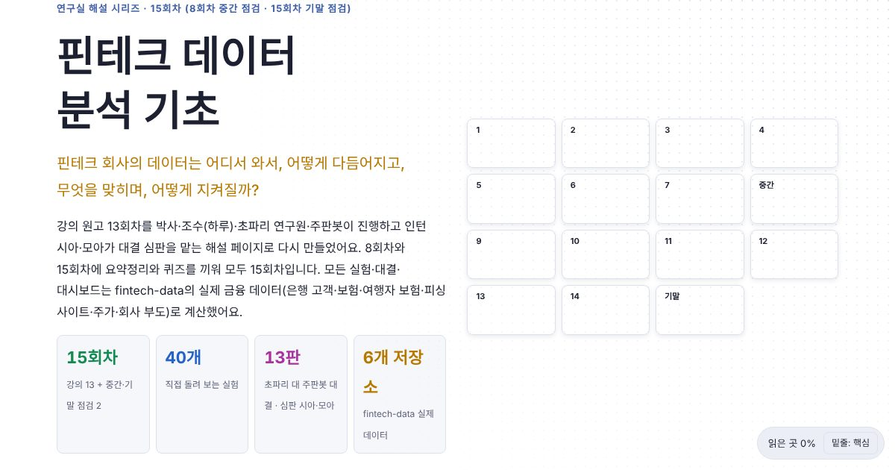

# 핀테크 데이터 분석 기초 — 연구실 해설



> 핀테크 회사의 데이터는 어디서 와서, 어떻게 다듬어지고, 무엇을 맞히며, 어떻게 지켜질까?

강의 원고 「핀테크 데이터 분석 기초」 1~13회차를 **비전공 독자용 연구실 해설 페이지**로 다시 만든 시리즈입니다. 8회차(중간)와 15회차(기말)에 요약정리·퀴즈를 끼워 **모두 15회차**입니다. 박사 · 조수(하루) · 초파리 연구원 · 주판봇이 진행하고, 대결에서는 인턴 시아·모아가 심판을, 아직 공개되지 않은 식구 X1·X2·X3가 방청석을 맡습니다.

모든 실험·대결·대시보드는 **[fintech-data](https://github.com/fintech-data)의 실제 공개 금융 데이터**를 이 저장소 `data/`로 복사해 계산했습니다.

- **바로 보기:** https://adminmrobo.github.io/fintech_data_analysis/

## 첫 화면 — 핀데이터 그룹 여의도 본사 타워 (3D)

가상의 핀테크 기업 **핀데이터 그룹(FinData Group)** 여의도 본사는 **쌍둥이 타워**입니다. 서관에 1~7층(1부), 동관 고층부에 9~14층(2부)과 15층 전망대가 있고, 두 동을 잇는 **8층 스카이브리지 라운지**에서 중간 점검을 합니다. 회차 하나가 부서 하나, 부서 하나가 한 층입니다.

| 층 | 부서 | 쪽 |
|---|---|---|
| 15F (동관) | 전망대 · 기말 점검 | 15 기말 요약정리 및 퀴즈 (9~14회차) |
| 14F | 정보보호·데이터 거버넌스 센터 | 14 데이터 보안 및 품질 관리 |
| 13F | 로보어드바이저 사업부 | 13 데이터 기반 핀테크 서비스 기획 |
| 12F | 데이터 시각화 스튜디오 | 12 핀테크 데이터 시각화 |
| 11F | 시장 데이터 랩 | 11 딥러닝 모델과 시계열 데이터 분석 |
| 10F | 신용 리스크 모델링실 | 10 회귀모형(2) — 로지스틱·결정나무·특성공학 |
| 9F | 보험 가격 산정팀 | 09 회귀모형(1) |
| 8F (스카이브리지) | 중간 점검 라운지 | 08 중간 요약정리 및 퀴즈 (1~7회차) |
| 7F | 모델 검증실 | 07 데이터 분석 모델의 평가 |
| 6F | 고객 이탈 분석팀 | 06 데이터 분석 실습 — KNN·SVM·분할·표준화 |
| 5F | 데이터 전처리 센터 | 05 분류모형(1) — Colab과 전처리 |
| 4F | 분석 도구 지원실 | 04 데이터 분석 개념의 이해 |
| 3F | 데이터 기획실 | 03 데이터 분석을 위한 준비 — 수집 계획 |
| 2F | 데이터 수집팀 | 02 핀테크 데이터 수집 기술 |
| 1F | 핀테크 전략기획실 | 01 핀테크 산업의 이해와 핀테크 데이터 |
| L | 로비 · 안내 데스크 | 목차 |

표지 16장은 모두 16비트 픽셀아트입니다. 3D는 three.js(jsdelivr CDN)로 그립니다. 불러오지 못하면 오른쪽 안내판만으로 이동할 수 있어요. 회사·지사 설정은 설명용 가상 설정입니다.

## 구성과 대결

| 쪽 | 실습 데이터 | 대결 | 결과 |
|---|---|---|---|
| [01](01_fintech_industry.html) | 은행 고객 10,127명 | 행동 1칸 vs 인구통계 16칸 (AUC) | 초파리 |
| [02](02_data_collection.html) | 보험 1,338명 · 피싱 1,353개 | 점검한 600건 vs 라벨 오류 947건 (재현율) | 초파리 |
| [03](03_collection_plan.html) | 대출 데이터 사전 78칸 · 주가 | 월 1회 수집 vs 매일 수집 (오차) | 주판봇 |
| [04](04_analysis_concepts.html) | 은행 고객 | 시험 점수로 고른 k=15 vs 학습 점수 99.8% k=1 | 초파리 |
| [05](05_preprocessing.html) | 은행 고객 | Unknown 범주 유지 vs 행 삭제 | 무승부 |
| [06](06_knn_svm.html) | 은행 고객 | 표준화 SVM vs 그대로 SVM (재현율) | 초파리 |
| [07](07_model_evaluation.html) | 여행자 보험 63,326건 | 로지스틱 vs "모두 청구 없음" | 조건부 |
| [08](08_midterm_review.html) | — | 중간 점검: 교안 35문항 · 계산 7문제 | — |
| [09](09_regression.html) | 쇼핑몰 1,000명 · 보험 | 선형 vs KNN 회귀 (외삽 MAE) | 초파리 |
| [10](10_logistic_tree.html) | 은행 고객 · 보험 · 부도 6,819개사 | 기본 특성 3개 vs 만든 특성 6개 (R²) | 주판봇 |
| [11](11_deep_learning_timeseries.html) | 주가 2013~2019 | "내일 = 오늘" vs AR(10) (MAE) | 초파리 |
| [12](12_visualization.html) | 보험 · 주가 · 국제 지표 | 중앙값 vs 평균 (MAE / RMSE) | 조건부 |
| [13](13_robo_advisor.html) | 주가 2013~2019 | 사서 보유 vs 이동평균 교차 (아마존 / 비트코인) | 조건부 |
| [14](14_security_quality.html) | 보험 · 원자료 전체 | 덜 묶은 비식별 vs 크게 묶은 비식별 (위험 인원) | 주판봇 |
| [15](15_final_review.html) | — | 기말 점검: 교안 30문항 · 계산 6문제 | — |

대결 결과는 초파리 6 · 주판봇 3 · 조건부 3 · 무승부 1로, "의심만 하면 이긴다"는 오해가 생기지 않게 나눴습니다.

## 각 회차 페이지의 구조

3D 본사 타워 → 표지 → 히어로 → **처음 오신 분께 — 이 페이지를 3줄로** → 연구실 식구 → 왜 이 주제인가 → 칸 ①②③ → **한눈에 보는 대시보드** → 대결 → 정리 → 아웃트로 → 지식 색인 → 온톨로지·서지 꾸러미 → 바닥글.

칸마다: 이 칸에서 가져갈 한 가지 · 왜 이 방법을 쓰나 · **수학 수식을 어려워하는 조수가 대신 물어봅니다**(학교 수학 단원 → 식 조각 표 → 숫자로 한 번 해 보기) · 일상으로 치면 | 데이터 분석으로는 · 칸 대화 · 실험 · 풀이와 한계 · 업무에 쓸 때 · 접어 둔 파이썬 코드 · 확인 퀴즈(칸 ③에는 **AI 판단** 문항 1개).

화면은 모두 흰 배경이며, 각 페이지는 외부 파일 없이 열립니다(글꼴·3D만 CDN).

## 실습 노트북과 강사용 가이드

- **회차별 Colab 노트북** `notebooks/` — 13개(01~07, 09~14). 페이지의 실험·대결 숫자를 같은 데이터·같은 시드(42)로 다시 계산하며, 실행 결과까지 저장돼 있습니다. 각 페이지의 3줄 요약 상자와 코드 상자에 「Colab에서 열기」 링크가 있어요.
  예: [01 노트북 Colab에서 열기](https://colab.research.google.com/github/adminmrobo/fintech_data_analysis/blob/main/notebooks/01_fintech_industry.ipynb)
- **강사용 진행 가이드** [`docs/INSTRUCTOR_GUIDE.md`](docs/INSTRUCTOR_GUIDE.md) — 100분 기준 진행 순서, 회차별 3줄 요약·칸별 핵심·대결 설정·칠판 문장·원자료와 다른 곳.

## 검토 반영

- **수포자 스킬(supoja-content) 검토:** AI 판단 문항 13개, 기호 읽는 법(Σ·e·φ·σ·R² 등), 손계산 예시 보강 — `src/pages/_supoja.py`
- **페르소나 감사(persona-review):** 코드 예시 오류 수정, 대시보드 라벨 겹침 수정, 실행 가능한 Colab 노트북·강사용 가이드 추가, 휴대폰(폭 700px 이하)·데이터 절약 모드에서는 3D 타워를 버튼을 눌렀을 때만 불러오도록 변경

## 원자료와 다르게 쓴 곳 (주요 항목)

| 회차 | 원자료 | 이 시리즈 |
|---|---|---|
| 5·6·9·10 | 생선·와인·농어 실습 데이터 | fintech-data 은행 고객·보험·마케팅 데이터로 같은 과정 |
| 11 | yfinance 페이팔 주가(실행 시점마다 달라짐) | 저장소 내 주가 2013~2019 + "내일 = 오늘" 기준 비교 추가 |
| 7 | 보험 청구 사례 "정확도 77% → 97%" | 같은 데이터에서 "모두 청구 없음"이 98.5%라 재현율·AUC로 설명 |
| 7 | 은행 이탈 비율 99:1 | 실제 84:16 (8,500 : 1,627) |
| 3·4·5 | 문제풀기 정답 표시가 해설과 다른 문항 | 8회차 중간 점검에서 바로잡음 |
| 회차 번호 | 원고 8~13회차 | 이 시리즈 9~14회차 (8회차에 중간 점검) |

자세한 내용은 각 페이지 바닥글의 "원자료와 다르게 쓴 곳"에 있습니다. 금융 회차(11·13)와 주가 실험은 **교육용이며 투자 자문이 아닙니다.**

## 파일

```
index.html, 01_…html ~ 15_…html   목차와 15회차 (08·15는 요약정리 및 퀴즈)
KG_00_registry.json               시리즈 지식 그래프 등록부
data/                             fintech-data 복사본 (data/README.md)
notebooks/                        회차별 Colab 실습 노트북 13개 (실행 결과 포함)
assets/og_series.jpg, og/         공유 미리보기 (픽셀아트 표지에서 자동 생성)
assets/thumb_portfolio.webp       포트폴리오 카드 그림 (Genspark 픽셀아트, 원본 docs/portfolio_fintech_1920.png)
docs/COVER_PROMPTS_series.md      표지 16장 그림 지시문 (Genspark용, 작업 순서 포함)
docs/IMG_00_index.md              이미지 제작 명세서
docs/INSTRUCTOR_GUIDE.md          강사용 진행 가이드
src/analysis/compute.py           실제 데이터 계산 (시드 42) → results.json
src/pages/*.py                    페이지 데이터 (_supoja.py: 수포자 스킬 검토 반영)
src/build/                        빌드 도구 (build.py, sims.js, dash.js, tower.*)
```

## 다시 빌드하기

```bash
# 캐릭터 그림 묶음 sprites.json 은 저장소에 넣지 않았습니다.
# ahnboat_lab_explainer 캐릭터 팩의 sprites_96.js(LAB_PACK)에서 alias·facing·img 를 뽑아 src/build/sprites.json 으로 두세요.
cd src
python3 analysis/compute.py          # data/ → analysis/results.json
python3 build/build.py ..            # 저장소 루트에 16쪽 생성
mkdir -p out/docs && python3 build/make_docs.py   # 그림 지시문 (out/docs → docs/)
node build/check.js ../*.html        # 390·1280px 가로 넘침·콘솔 오류 점검 (Playwright)
python3 build/make_notebooks.py      # Colab 노트북 생성·실행 (nbformat, nbclient, ipykernel 필요)
python3 build/make_guide.py          # docs/INSTRUCTOR_GUIDE.md
```

### 표지 그림 넣기

Genspark에서 받은 그림을 저장소 루트 `incoming/` 폴더에 `cover_00.png` ~ `cover_15.png` 이름으로 넣고:

```bash
cd src
python3 build/add_covers.py          # → build/covers/cover_NN.webp (1600×900, 220KB 이하) + assets/og/ 공유 그림
python3 build/build.py ..            # 표지·목차 썸네일 자동 반영
```

## 출처

- 안상선 (2024). 핀테크 데이터 분석 기초 1~13회차 강의 원고 v1.0~1.1 (NCS 핀테크 데이터 분석 2001010802_19v2).
- 실습 데이터: fintech-data, Revolution~Revolution6, https://github.com/fintech-data

---

글 · 안상선 ([www.ahnboat.xyz](https://www.ahnboat.xyz)) · (주)M-Robo 대표

캐릭터(박사 · 조수(하루) · 초파리 연구원 · 주판봇 · 시아 · 모아 · X1~X3)의 이름·설정·그림의 저작권은 안상선(개인)에게 있으며 허락 없이 쓸 수 없습니다. 그림: 캐릭터 팩 (fruitfly-lab-expressions @ 86d04ac, ahnboat_lab_explainer 캐릭터 팩).
